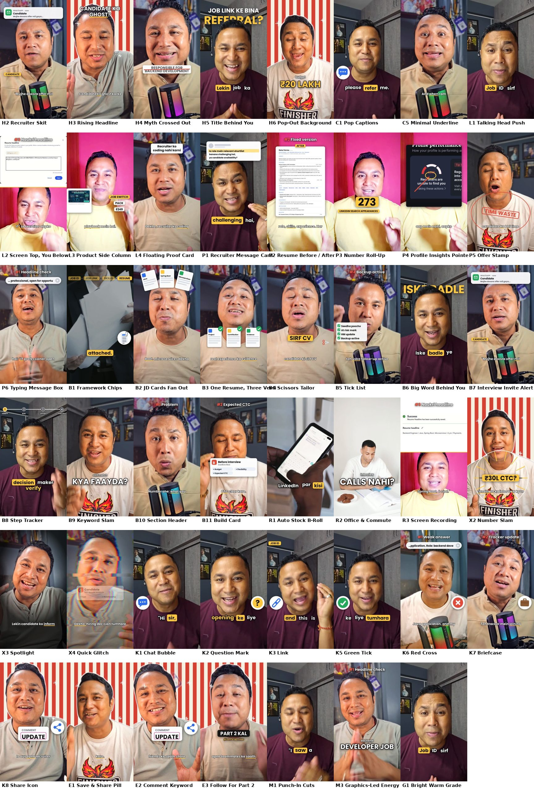

# Career Reels — Daily Reel SOP

17 Nov 2026 · Live version: https://claude.ai/artifact/Q9nk8WzEYTDwwWRhdr9KwU (this file is a backup copy; the live doc wins if they differ)

One fixed process for every daily reel: you record and send, Claude edits on the Energy v3 base, and nothing renders until you approve the storyboard.

## Start of every chat

The first thing any new chat does for a reel is load this SOP. The Career Reels folder and the GitHub repo are the only home of this project.

1. Read this SOP (the GitHub copy is `docs/Daily-Reel-SOP.md`; the live doc wins if they differ), the repo's `CLAUDE.md`, and the `career-reels-editor` and `career-reels-broll` skills.
2. Open `D:\Prafulla Goal\Career Reels` (laptop on) or clone `rajdeori2019/career-reels` (laptop off).
3. Look at the style reference frames (`docs/style-frames/`) before choosing any style.
4. Run the steps below in order, with both gates.
5. After every render, update GitHub (step 13). No exceptions.

## The daily run

Every reel goes through the same 13 steps and two approval gates. Claude never moves past a gate without your OK.

| # | Step | Who | What comes out |
| --- | --- | --- | --- |
| 1 | Record the video (checklist below) | You | Raw video, 30–90 s of content |
| 2 | Upload and send `make reel <link or file name>` + thumbnail, proof or screen recording if any | You | The request |
| 3 | Load the system (Start of every chat), start from `tools/templates/approved_energy_v3.json` | Claude | Same base every day |
| 4 | Inspect, find pauses, transcribe (Hindi + English pass), write Roman Hinglish captions | Claude | Timed caption lines |
| 5 | **Pick the styles from the recording**: line by line from the line-to-style map (Proven only), at least 4 extras with 2 not used in the last 3 reels, checked against the reference frames | Claude | Style codes |
| 6 | **Check the background**: if the wall doesn't fit, switch to the navy studio automatically | Claude | Background choice |
| 7 | Plan cuts, handle, proof and B-roll moments | Claude | Draft plan |
| 8 | **Gate 1: confirmation reply.** Captions, cuts, speed, styles, handle, background, asset plan | You approve | "OK" or corrections |
| 9 | Find and fetch assets: proof, screen recordings, own B-roll, then Pexels/Pixabay; build the spec; run `cut` and `matte` | Claude | Working files + B-roll picks sheet |
| 10 | **Gate 2: full storyboard.** Every page, plus the B-roll picks sheet | You approve | "OK" or panel fixes |
| 11 | Render in chunks, join, loudness to −14 LUFS, then QA | Claude | Final MP4 that passed QA |
| 12 | Deliver to `Finished` with cover, credits and the spec in `tools/incoming/` | Claude | Reel ready to post |
| 13 | **Update GitHub**: run `tools/repo_sync.py`, commit and push to `rajdeori2019/career-reels`, report the commit | Claude | Repo up to date |

**Two hard rules:** no full render without an approved storyboard, on the laptop or in the cloud; and no render ends without the GitHub update in step 13. A fix you ask for on the storyboard is shown again as a new storyboard before rendering.

## Your part

Your job is a clean recording and one short message. Everything else is Claude's.

**Before you record**

- [ ] Phone vertical, camera at eye level, talking straight to camera
- [ ] 30–90 s of real content; a bad take is fine, just say the line again (Claude cuts repeats and false starts)
- [ ] Space above your head. Graphics sit at the top and at chest height, never on your face
- [ ] A plain wall if you can. A strong red, pink or busy wall forces the navy background swap
- [ ] Hook as the first spoken line; end with the CTA in your own words (e.g. "save karo aur share karo")
- [ ] Proof ready: screenshots in `Proof/`, screen recordings in `Screen Recordings/`. Blur other people's names, CTC and contacts
- [ ] Recording a profile edit on screen? Press Cancel, not Save, so your real profile doesn't change

**What to send**

| Where you are | Do this | Message |
| --- | --- | --- |
| Phone, laptop on or off | Upload to Drive → `Career Reels/Raw Videos`, copy the link | `make reel <link>` |
| Phone, newest video | Upload to the same Drive folder | `make reel` |
| Laptop | Drop the file in `Raw Videos` | `make reel <file name>` |

Optional additions to the same message: the thumbnail (becomes the cover), "show Proof/naukri.png on line 9", "navy background", style codes from the Style Guide, or "match the reference reel <name>". Videos over 30 MB: send the Drive link, never the attachment.

## Gate 1: the confirmation reply

Claude picks the design itself after the transcript and sends one reply that covers everything. You answer once: "OK" or corrections.

| Part of the reply | What it shows | Rule |
| --- | --- | --- |
| Caption table | Every line with its source time, Roman Hinglish exactly as spoken | Unsure words marked ⚠. Captions only from words you confirm |
| Cuts | False starts, repeated takes, repeated phrases, pauses over ~0.35 s | If two takes exist, Claude asks which one to keep |
| Speed | 1.2x | Change only if you say so |
| Design line | `Design: Energy v3 (+ header, typing box, …) at 1.2x` | Reel type, every style code picked from the recording and the reel its reference frame comes from. Reply OK, or name other codes |
| Styles not used recently | Output of `python3 tools/style_map.py recent`, and which of them this reel uses | At least 4 extra Proven styles on top of Energy v3, at least 2 not in the last 3 reels |
| Handle | `@iamprafz` or `@i.am.a.recruiter` | Job-seeker topic → @iamprafz; recruiter topic → @i.am.a.recruiter |
| Background | Real room or navy studio | Chosen automatically from the wall, with the reason (see Background change) |
| Asset plan | Which line gets proof, a screen recording, B-roll or a split screen | Proof first, stock last |

Correct any wrong caption word here. It is the cheapest point to fix it.

## Design rules

Energy v3 is the base of every reel, including tests. Any other style goes on top of it, never instead of it. Energy comes from a new graphic tied to your words every 1.5–3 s, not from zooms, flashes or faster speech.

**The Energy v3 base (style codes `H6 C5 L1 P6 B6 B9 B10 B11 E1 M3 S1 S2 G1 A1`)**

- [ ] Pop-out background (H6) on the hook, from frame 0, with the hook title
- [ ] Keyword slam (B9) on the key phrase of almost every line: small word above a BIG word, yellow or white
- [ ] Minimal captions (C5), active word underlined in yellow; they step aside during a keyword slam
- [ ] Section header (B10) for numbered steps
- [ ] Typing box (P6) for any message, DM, email or question you quote
- [ ] Build card (B11) for any list or formula
- [ ] One big word behind you (B6) on the turn of the story, with one small shake
- [ ] SFX on each graphic, soft music bed, bright warm grade, clean voice
- [ ] Pop-out background again on the CTA, then the Save & Share pill with the right handle (E1)
- [ ] Speed 1.2x, gentle zoom only (no punch-ins, no cut flash, no stickers)

**Which graphic goes with which line**

| When the line is… | Use | Code |
| --- | --- | --- |
| The hook (first spoken line) | Pop-out background + keyword or title | H6 + B9 |
| Any line with a key phrase | Keyword slam | B9 |
| A message, DM, email or interviewer question you quote | Typing message box | P6 |
| Numbered steps (#1, #2, #3) | Section header across the top | B10 |
| A list or formula of 3–4 items | Build card with chips and a badge | B11 |
| The turn (LEKIN, ISKE BADLE, SOLUTION?) | Big word behind you + shake | B6 |
| A wrong belief, then the truth | Myth crossed out | H4 |
| Before and after (resume, profile) | Before/after wipe | P2 |
| A real number or result | Number roll-up, or Number slam as the showpiece | P3 / X2 |
| A real recruiter message | Recruiter message card, names blurred | P1 |
| A screen you are explaining | Screen on top, you below | L2 |
| A recruiter → candidate exchange | Skit labels | H2 |
| Series content | "Part 2 tomorrow" card instead of Save & Share | E3 |
| A freebie or lead magnet | Comment keyword card | E2 |

**Limits:** one showpiece effect per reel at most (X1 whip flash, X2 number slam, X3 spotlight, X4 glitch, X5 grid). Teaching beats like header, build card and tick list: two or three per reel, not on every line. Ready styles (H7, C3, C4, M2, R4, E4, X5) only when you ask; C3, C4 and M2 replace parts of Energy v3, so they need your explicit OK.

Full catalogue: TRI Reel Style Guide, 61 styles (54 Proven, 7 Ready). A style moves from Ready to Proven once it appears in a reel you approve.

## Choosing the style from the recording

Claude decides the styles itself from the raw recording. You don't pick codes unless you want to. Every pick comes from the TRI Reel Style Guide, which is tested and proven on your own reels, and always sits on the Energy v3 base.

**How Claude decides (step 5)**

1. **Watch the recording:** stills from the start, middle and end, plus the transcript.
2. **Read the content:** what kind of reel it is, and which lines hold a quote, steps, a list, a number, a before/after or a turn.
3. **Read the frame:** room above your head, how much of the frame your face fills, hands in shot, and the wall (see Background change).
4. **Check what proof exists** in `Proof/` and `Screen Recordings/` for this topic.
5. **Pick styles line by line** from the line-to-style map below, on top of Energy v3, meeting the variety rule.
6. **Match the look** to each style's reference frame (below) so it renders like the approved version.

**Line-to-style map (24 Nov 2026).** Go line by line through the transcript and pick from this map. It covers all 54 Proven styles. The reel type is just a label now; the lines decide the styles. Same map in code: `python3 tools/style_map.py menu`.

| The line is… | Proven styles that fit |
| --- | --- |
| Hook (first spoken line) | H6 always + one of H1 question pill, H3 rising headline, H4 myth, H5 title behind you (needs headroom), B9 keyword |
| Recruiter / HR asks something, a skit | H2 skit labels, P6 typing box, K2 question mark |
| Quoted message, DM, email, pitch line | P6 typing box, P1 message card, K1 chat bubble |
| Reply, invite or result arrives | B7 phone alert, P1 message card, P5 stamp |
| Myth / wrong belief | H4 myth crossed out, K6 red cross |
| Right way / do this | K5 green tick, B5 tick list, B11 build card |
| Wrong way / don't | K6 red cross, H4 myth |
| A list or checklist | B5 tick list, B11 build card, B8 step tracker |
| Numbered steps / method | B10 section header, B8 step tracker, B1 chips |
| Framework or comparison (problem->result, A vs B) | B1 chips, B11 build card, L3 side column |
| A number: salary, %, views, calls | P3 number roll-up, X2 number slam (showpiece), P5 stamp |
| Offer / win / cleared a round | P5 stamp, B7 phone alert, K7 briefcase |
| Jobs, roles, JDs | B2 JD cards fan out, K7 briefcase |
| Resume / CV | K4 resume page, B3 one resume three versions, P2 before/after |
| Tailor / cut / shorten | B4 scissors tailor, B3 resume split |
| Link / profile / URL | K3 link, L2 screen top, P4 insights pointer |
| Proof on a screen (LinkedIn, Naukri, dashboard) | L2 screen top you below, P4 insights pointer, R3 screen recording, L4 floating proof card |
| Showing a document / product | L3 side column, L4 floating proof card |
| The turn (lekin, iske badle, but) | B6 big word behind you, X4 quick glitch (showpiece) |
| Emotional big line | X3 spotlight (showpiece) |
| Office, commute, first-job story | R2 office & commute B-roll, R1 stock B-roll |
| Concept with no footage of your own | R1 auto stock B-roll |
| Key phrase of any line | B9 keyword slam |
| Share / send / forward | K8 share icon, E1 save & share |
| Ending: useful tip | E1 save & share |
| Ending: comment a keyword | E2 comment keyword (+ E1) |
| Ending: series | E3 follow for part 2 (+ E1) |
| Result line that needs a push | M1 punch-in (max 2) |
| Always (Energy v3 base) | C5 L1 M3 S1 S2 G1 A1 |

**Variety rule (checked by `spec_lint.py`, a FAIL blocks the storyboard):**
- At least **4 extra Proven styles** on top of the Energy v3 base.
- At least **2 of them not used in the last 3 reels** in `docs/Reels-Log.md`. Run `python3 tools/style_map.py recent` to see the fresh ones.
- **Every code in `style_codes` must really be in the spec** (`python3 tools/style_map.py check spec.json`). No listing a code that is not on screen.
- **One showpiece** (X2, X3 or X4) per reel.
- Add `"reel": "<Name>"` to the spec (same name as the log row).

**Energy v3 status of every Proven style:**
- Allowed within limits: **K1–K8 clip-art** max 2 per reel at shoulder height (y 1000–1250, x ≤ 200 or ≥ 880, never on the face); **M1 punch-ins** max 2 per reel, only on key lines.
- Not with Energy v3: **C1 Pop captions** and **C2 Keywords only** (they replace C5), **X1 Whip flash** (ads pipeline only). Listing them fails the check.
- Every other Proven style is fine on Energy v3. H5 needs room above your head; with no headroom use B9 instead.

**Frame rules:** no room above your head → no behind-you title (H5/H7), use a keyword slam. Face fills the frame → lower zoom or a split screen. Hands out of shot → keep the bottom-anchored zoom low. Only Proven styles by default; Ready ones (H7, C3, C4, M2, R4, E4, X5) only when you ask.

**In the Gate 1 reply** Claude names the reel type, every code it picked with the line it sits on, the "styles not used recently" line, and for each extra style the approved reel its reference frame comes from (e.g. "P2 → Resume No Calls proof reel").

### Style reference frames

Every Proven style has a real frame from one of your approved reels, 47 in all. Claude looks at the frame before using a style. Each frame is its own file in `docs/style-frames/<CODE>.jpg`, listed in `docs/Style-Reference.md`, and in the interactive guide `TRI Reel Style Guide.html` in your folder (online: https://claude.ai/artifact/NSN1Ha3ok3r7VCqg7hCPg5).

Frames come from ten approved reels: Referral Job Link, Recruiter Cold DM, Budget vs CTC, Resume No Calls proof, 8+ yrs Resume Evidence, Naukri Headline, Tell Me About Your Project, Friday Backout, No Update and Shortlist Bharosa. Proven styles without a frame yet: H1, C2, X1, K4 (drawings in the guide) and the sound-only S1, S2, A1.

## Placement: words never on your face

No text or graphic ever covers your face. On 16 Nov the first storyboard put words on your face and had to be redone, so Claude now measures the face area on stills of each new video, at the strongest zoom, before placing anything.

| Element | Where (1080×1920 frame, your usual close framing) |
| --- | --- |
| Top graphics: header, chips, hook title | y 110–250 |
| Cards, stamps, rings, tick lists | Chest height, y 1000–1250 |
| Keyword slams | y 1330 |
| Minimal captions | y 1480 |
| Clip-art and side cards | Shoulder height at the screen edges only |
| Your face (typical) | x 280–800, y 450–1250 at 1.10 zoom |

- **If the face fills too much of the frame:** lower the zoom to 1.00–1.04 (as on the 16 Nov reel) and move text into the free space, or use a split screen (proof or B-roll on top, you below, zoomed out so your whole face fits).
- **Behind-you titles** (H5, H7) get hidden by your head in close framing. Use a keyword slam instead.
- **Cutaways** (before/after wipe P2, insights pointer P4, full-screen B-roll) may cover you briefly. The storyboard says so on that panel.
- **Safe zones:** nothing important in the strip Instagram covers at the bottom (caption and buttons) or the very top.

## Proof, screen recordings, B-roll and references

Real proof beats stock every time. Claude fills each visual moment in this order and stops at the first source that fits.

1. **Your proof** from `Proof/` (LinkedIn, Naukri, ebook, resume before/after screenshots): as a message card (P1), floating card (L4), insights pointer (P4) or before/after wipe (P2). Other people's names, CTC and contacts blurred first.
2. **Your screen recordings** from `Screen Recordings/`: screen on top, you below (L2), or a short full-screen cutaway (R3).
3. **Your own B-roll** from `B-roll/`, matched by file name, so name clips by what they show (e.g. `office-laptop-frustrated.mp4`).
4. **Stock B-roll** from Pexels, then Pixabay, via `broll.py`: portrait clips first, no logos, on-screen text or watermarks.
5. **AI B-roll (Veo)** only if you agree to the cost for that reel.

**B-roll rules**

- 3–5 moments per reel, each 1.2–2.5 s full-screen, starting on a word; a split screen can run for the whole line.
- Never over the hook (first 2 s), the CTA, or a proof moment.
- Entry: whoosh SFX and a slow push-in. A keyword slam can sit on top of a full-screen cutaway.
- Claude sends `picks.png` (one frame per pick, with its line) together with the storyboard. Weak match → Claude retries with a better query before asking you.
- `credits.txt` goes next to the final reel. Before using stock clips in a paid ad, read the Pexels and Pixabay licences.

**Reference reels** (`References/`, 5 clips): Claude studies them for pace, caption look, split-screen layout and hook style, and copies the feel only. Never their words, music or branding. To use one, say "match the reference reel <name>"; to cut a reference clip into your reel, say so explicitly.

## Background change

Claude checks the wall on the stills in step 6 and changes the background automatically when it doesn't fit. You don't need to ask; the Gate 1 reply says which background it chose and why.

**Switch to the navy studio when any of these is true:** the wall is a strong red, pink or another loud colour; it is busy (shelves, posters, clutter) or dark; keywords or captions are hard to read on the stills; or a picked style needs a plain, light wall (the Style Guide marks these, mostly the Showpiece effects). Otherwise keep your real room.

| Setting | Real room (default) | Navy studio |
| --- | --- | --- |
| Background | Your wall, graded | `tools/templates/bgA.png`, navy gradient with a soft glow behind your head |
| Pop-out pattern (hook and CTA) | `stripes` | `ink` (dark green, so white text reads) |
| Mattes | Only inside pop-out and behind-you windows | Every frame of the reel |
| Render cost | Normal | About 0.4 s per frame extra |
| Approved example | `Recruiter_Cold_DM_Reel_v3.mp4` | `Proxy_Interview_Verify_Reel_v3_navy.mp4` |

Spec for the switch: `"bg_replace": {"mode":"image","image":"<tools>/templates/bgA.png","clip":[0.4,0.85],"feather":2,"band":71,"spill_ratio":1.5}`. You can still force it with "navy background", or keep the real room with "keep my room".

Open decision: whether navy + ink becomes the default for every reel.

## SFX, VFX, music, grade and voice

Sound and finish are fixed. Claude doesn't pick them fresh each day.

| Moment | Sound effect |
| --- | --- |
| Hook pop-out, B-roll entry, header change, split screen, CTA pop-out | whoosh |
| Keyword slam, big word, badge landing | pop |
| Typing box start, build-card chip, step chip | tick |
| Save & Share pill | chime |

- **SFX level:** −22 dB, always under your voice. The engine's set is whoosh, pop, tick, chime and swish.
- **Music:** soft bed at 0.05 under voice, 0.10 in gaps, lifted after the last word.
- **Grade (G1):** brightness 0.045, contrast 1.12, saturation 1.15, vibrance 0.2, gamma 1.05, warm 0.03, vignette 0.2.
- **Camera:** zoom 1.08–1.12, alternating per cut, bottom-anchored so your hands stay in frame. Lower to 1.00–1.04 if text needs room.
- **VFX:** one small shake on the big word. At most one showpiece (whip flash, number slam, spotlight, glitch or grid) per reel.
- **Voice (A1):** noise and clipping cleaned, two-pass loudness to −14 LUFS, peak at or below −1.5 dB.

## Gate 2: the storyboard

After `cut` and `matte`, Claude runs `career_reel.py storyboard` and sends every page. Nothing renders until you reply OK.

**What the storyboard holds:** one panel per graphic moment, every line without a graphic, and the ending, 12 panels a page. Each panel shows the time, the caption and what is on screen, drawn on your real frame. The B-roll picks sheet comes with it.

**Claude's self-check before sending (any fail is fixed first):**

- [ ] No word or graphic on the face in any panel, checked at the strongest zoom
- [ ] Hook graphic from frame 0, held through the first spoken idea
- [ ] A new graphic every 1.5–3 s; no dead stretch longer than 3 s
- [ ] Every Energy v3 base item present (Design rules checklist)
- [ ] No two elements overlapping (e.g. header ending before a typing box starts)
- [ ] Captions match your confirmed words; the last caption matches your CTA
- [ ] Right handle on the Save & Share pill
- [ ] Proof blurred; no B-roll over the hook, CTA or a proof moment
- [ ] At most one showpiece effect
- [ ] Text inside the safe zones

**Your reply:** "OK" to render, or panel numbers with the fix, e.g. "panel 7: smaller keyword", "panel 3: words on my face". Claude fixes it, re-runs the storyboard and sends it again. A storyboard change always gets a fresh storyboard, never a straight render.

## Render, QA and delivery

Only after the storyboard OK. Claude renders in chunks (laptop: a few seconds of output per call; cloud: 8–18 s chunks), then joins them with voice, SFX and music.

**QA before you see it**

| Check | Pass mark |
| --- | --- |
| Format | H.264 + AAC, 1080×1920, 30 fps |
| Loudness | About −14 to −15 LUFS, peak at or below −1.5 dB |
| Chunk joins | No jump or flash at any join |
| Face | No graphic on the face in a contact sheet of every join and key beat |
| Captions | Same words as the approved storyboard |

**Delivered to `Career Reels/Finished`**

- `<Topic>_Reel_v1.mp4` (the reel), also sent in chat so you can watch it on the phone
- `<Topic>_Reel_v1_cover.png` when you sent a thumbnail. Set it as the Reel cover in Instagram
- `<Topic>_Reel_v1_credits.txt` when stock B-roll was used
- The spec saved as `tools/incoming/<Topic>_Reel_v1_spec.json` (same name as the reel) so it can be re-rendered and is linked in the reels log

After posting, move the file to `Finished/Posted`. A fix after delivery (one wrong word, one graphic) re-renders only that chunk.

### Step 13: GitHub update after every render

The GitHub repo `rajdeori2019/career-reels` is updated automatically after every render, approved or not yet posted, in the same chat. The laptop has no GitHub login, so Claude always pushes from its own session.

1. Attach the repo with push access and clone it.
2. Copy the Career Reels folder's `tools/`, `tools/incoming/*_spec.json` and the SOP and Style Guide files in (staged copies when the laptop is linked, the cloud working copy when it is off).
3. Run `python3 tools/repo_sync.py "<Career Reels copy>" <clone> --reel <Name> --date <YYYY-MM-DD> --handle <@handle> --styles "<codes>" --bg "<Real room or Navy studio>" --status Delivered`. It copies the engine, templates, the reel's spec and the docs, and adds a row to `docs/Reels-Log.md`.
4. Commit and push to `main`, then send you the commit link with the reel.
5. When you say a reel is posted, its log row changes to Posted in the next update.

Never pushed: videos, raw footage, `broll.env` or any `.env` file, and other people's private details. The repo is public.

## Proven reels and rejected looks

Copy what you approved; never repeat what you rejected.

**Approved reels to copy**

| Reel | Approved | What it proves |
| --- | --- | --- |
| `Tell_Me_About_Yourself_Reel_v1.mp4` (Posted) | 16 Nov, posted | Split screen (B-roll top, you below), full-screen B-roll cutaways, typing-box answers, words kept off the face. Spec in `specs/` |
| `Proxy_Interview_Verify_Reel_v3_navy.mp4` | 11 Nov, "this is good" | Navy background + ink pop-out, header steps, typing box |
| `Proof_Reel_Resume_No_Calls.mp4` (Posted) | 11 Nov | Real proof screenshots on Energy v3 |
| `Reel_C_Budget_vs_CTC.mp4` (Posted) | 11 Nov | Recruiter topic, @i.am.a.recruiter |
| `Recruiter_Cold_DM_Reel_v3.mp4` (Posted) | 10 Nov, "I am good with the v3 video" | **The Energy v3 default**, spec `approved_energy_v3.json` |
| `Referral_Job_Link_Reel_FINAL.mp4` (Posted) | 9 Nov, "awesome" | Referral look: pop captions, step chips, clip-art, spec `approved_referral_reel.json` |

Also approved on 11 Nov but not currently in `Finished`: the three T4v3 recruiter reels and Reel A, B and D.

**Rejected: never do these**

| Look | Your feedback |
| --- | --- |
| v2_energy: zoom punches, flashes, faster speech | Rejected 10 Nov. Energy comes from graphics, not camera tricks |
| A reel without the Energy v3 base | "Very basic" (11 Nov) |
| Plain basic captions only | Felt flat |
| Words over your face | Storyboard redone (16 Nov) |
| No B-roll or reference-style cutaways on a long talking reel | Storyboard redone (16 Nov) |
| CTA saying only "Save" | Always "Save & Share" |

## Where everything lives

The real working folder is `D:\Prafulla Goal\Career Reels`. The `Video editing with Claude` folder is older ad and long-video work, not the daily reel system.

| What | Where |
| --- | --- |
| Raw videos | `Raw Videos/` on the laptop, or Drive `Career Reels/Raw Videos` from the phone |
| Proof screenshots | `Proof/` |
| Screen recordings | `Screen Recordings/` |
| Own B-roll | `B-roll/` |
| Reference reels | `References/` |
| Finished and posted reels | `Finished/`, `Finished/Posted/` |
| Engine | `tools/career_reel.py`, `tools/career_styles2.py`, `tools/broll.py`, `tools/hinglish_asr.py`, `tools/repo_sync.py` |
| Approved looks | `tools/templates/approved_energy_v3.json`, `approved_referral_reel.json`, `bgA.png` |
| Style Guide (proven, with reference frames) | Folder: `TRI Reel Style Guide.html`, `TRI Reel Style Guide.md`, `TRI Reel Style Guide - all styles.pdf`. GitHub: `docs/TRI-Reel-Style-Guide-interactive.html`, `docs/Style-Reference.md`, `docs/style-frames/`. Online: https://claude.ai/artifact/NSN1Ha3ok3r7VCqg7hCPg5 |
| Reels log | GitHub `docs/Reels-Log.md`, one row per rendered reel |
| Stock API keys | `broll.env` (never shared, never in GitHub) |
| Code + SOP home | GitHub https://github.com/rajdeori2019/career-reels (public; no keys, no videos). Start-here rules for new chats: `CLAUDE.md`; this SOP: `docs/Daily-Reel-SOP.md` |
| Claude's instructions | Skills `career-reels-editor` and `career-reels-broll` |

**Laptop off:** the same SOP runs in the cloud from the Drive link and the GitHub code. The reel arrives in chat; it is copied to `Finished` the next time the laptop is linked.

**Ads are separate:** Meta ad videos for the ebooks use the `reel-video-editor` workflow (Remotion, about 8 preview stills before render), not this SOP.
