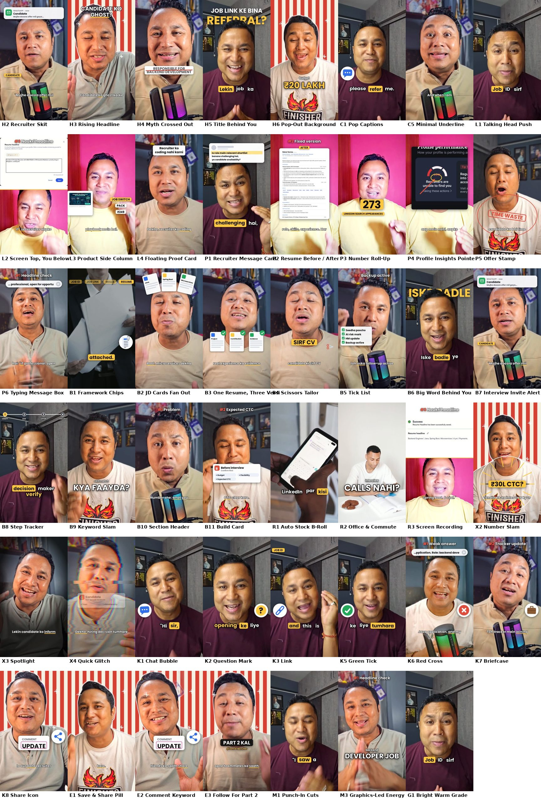

# TRI Reel Style Guide — reference frames

Every Proven style below has a real frame from one of Prafulla's approved reels. Claude looks at these frames before building a reel so each style matches the approved look. Full interactive guide (tap to enlarge, build a prompt): `TRI-Reel-Style-Guide-interactive.html` · online https://claude.ai/artifact/NSN1Ha3ok3r7VCqg7hCPg5

| Code | Style | Reference frame from | Frame |
| --- | --- | --- | --- |
| H2 | Recruiter Skit | Friday Backout reel | [H2.jpg](style-frames/H2.jpg) |
| H3 | Rising Headline | No Update reel | [H3.jpg](style-frames/H3.jpg) |
| H4 | Myth Crossed Out | 8+ yrs Resume Evidence reel | [H4.jpg](style-frames/H4.jpg) |
| H5 | Title Behind You | Referral Job Link reel | [H5.jpg](style-frames/H5.jpg) |
| H6 | Pop-Out Background | Budget vs CTC reel | [H6.jpg](style-frames/H6.jpg) |
| C1 | Pop Captions | Referral Job Link reel | [C1.jpg](style-frames/C1.jpg) |
| C5 | Minimal Underline | 8+ yrs Resume Evidence reel | [C5.jpg](style-frames/C5.jpg) |
| L1 | Talking Head Push | Referral Job Link reel | [L1.jpg](style-frames/L1.jpg) |
| L2 | Screen Top, You Below | Resume No Calls proof reel | [L2.jpg](style-frames/L2.jpg) |
| L3 | Product Side Column | Resume No Calls proof reel | [L3.jpg](style-frames/L3.jpg) |
| L4 | Floating Proof Card | Shortlist Bharosa reel | [L4.jpg](style-frames/L4.jpg) |
| P1 | Recruiter Message Card | Recruiter Cold DM reel (1.2x) | [P1.jpg](style-frames/P1.jpg) |
| P2 | Resume Before / After | Resume No Calls proof reel | [P2.jpg](style-frames/P2.jpg) |
| P3 | Number Roll-Up | Resume No Calls proof reel | [P3.jpg](style-frames/P3.jpg) |
| P4 | Profile Insights Pointer | Resume No Calls proof reel | [P4.jpg](style-frames/P4.jpg) |
| P5 | Offer Stamp | Budget vs CTC reel | [P5.jpg](style-frames/P5.jpg) |
| P6 | Typing Message Box | Naukri Headline reel | [P6.jpg](style-frames/P6.jpg) |
| B1 | Framework Chips | Referral Job Link reel | [B1.jpg](style-frames/B1.jpg) |
| B2 | JD Cards Fan Out | Shortlist Bharosa reel | [B2.jpg](style-frames/B2.jpg) |
| B3 | One Resume, Three Versions | Shortlist Bharosa reel | [B3.jpg](style-frames/B3.jpg) |
| B4 | Scissors Tailor | Shortlist Bharosa reel | [B4.jpg](style-frames/B4.jpg) |
| B5 | Tick List | Friday Backout reel | [B5.jpg](style-frames/B5.jpg) |
| B6 | Big Word Behind You | Referral Job Link reel | [B6.jpg](style-frames/B6.jpg) |
| B7 | Interview Invite Alert | Friday Backout reel | [B7.jpg](style-frames/B7.jpg) |
| B8 | Step Tracker | Recruiter Cold DM reel (1.2x) | [B8.jpg](style-frames/B8.jpg) |
| B9 | Keyword Slam | Budget vs CTC reel | [B9.jpg](style-frames/B9.jpg) |
| B10 | Section Header | 8+ yrs Resume Evidence reel | [B10.jpg](style-frames/B10.jpg) |
| B11 | Build Card | Budget vs CTC reel | [B11.jpg](style-frames/B11.jpg) |
| R1 | Auto Stock B-Roll | Referral Job Link reel | [R1.jpg](style-frames/R1.jpg) |
| R2 | Office & Commute | Naukri Headline reel | [R2.jpg](style-frames/R2.jpg) |
| R3 | Screen Recording | Resume No Calls proof reel | [R3.jpg](style-frames/R3.jpg) |
| X2 | Number Slam | Budget vs CTC reel | [X2.jpg](style-frames/X2.jpg) |
| X3 | Spotlight | No Update reel | [X3.jpg](style-frames/X3.jpg) |
| X4 | Quick Glitch | No Update reel | [X4.jpg](style-frames/X4.jpg) |
| K1 | Chat Bubble | Referral Job Link reel | [K1.jpg](style-frames/K1.jpg) |
| K2 | Question Mark | Referral Job Link reel | [K2.jpg](style-frames/K2.jpg) |
| K3 | Link | Referral Job Link reel | [K3.jpg](style-frames/K3.jpg) |
| K5 | Green Tick | Referral Job Link reel | [K5.jpg](style-frames/K5.jpg) |
| K6 | Red Cross | Tell Me About Your Project reel | [K6.jpg](style-frames/K6.jpg) |
| K7 | Briefcase | Friday Backout reel | [K7.jpg](style-frames/K7.jpg) |
| K8 | Share Icon | No Update reel | [K8.jpg](style-frames/K8.jpg) |
| E1 | Save & Share Pill | Budget vs CTC reel | [E1.jpg](style-frames/E1.jpg) |
| E2 | Comment Keyword | No Update reel | [E2.jpg](style-frames/E2.jpg) |
| E3 | Follow For Part 2 | Shortlist Bharosa reel | [E3.jpg](style-frames/E3.jpg) |
| M1 | Punch-In Cuts | Referral Job Link reel | [M1.jpg](style-frames/M1.jpg) |
| M3 | Graphics-Led Energy | Naukri Headline reel | [M3.jpg](style-frames/M3.jpg) |
| G1 | Bright Warm Grade | Referral Job Link reel | [G1.jpg](style-frames/G1.jpg) |

No frame yet: H1 Question Pill, C2 Keywords Only, X1 Whip Flash and K4 Resume Page are Proven but shown as drawings; S1 Light SFX, S2 Music Bed and A1 Clean Voice are sound-only. Ready (drawing only, not in a posted reel): H7, C3, C4, M2, R4, E4, X5. A Ready style becomes Proven after it appears in a reel Prafulla approves; then add its frame here and in the guide.
